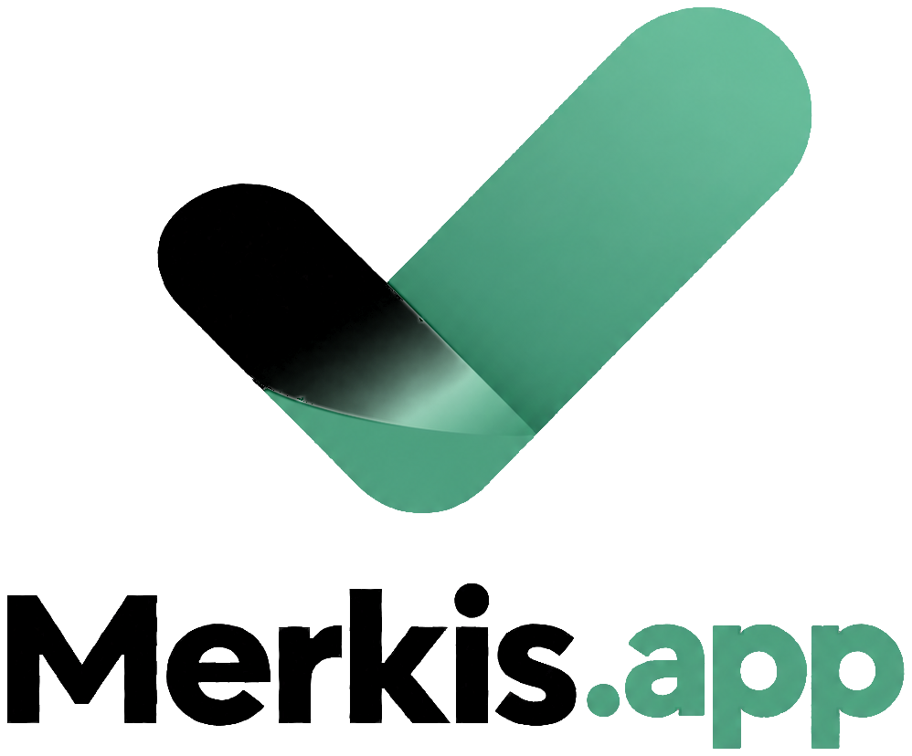

<p align="center">
  <a href="https://merkis.app">
    <picture>
      <source media="(prefers-color-scheme: dark)" srcset="frontend/src/assets/Logo.png">
      <source media="(prefers-color-scheme: light)" srcset="frontend/src/assets/Logo-light.png">
      
    </picture>
  </a>
</p>

<p align="center">A focused planner for daily goals.</p>

<p align="center">
  <a href="https://merkis.app"></a>
  
  
  
  
  
</p>

## Overview

Merkis (from the Latvian *mērķis*, "goal") is a full-stack web application with a Vue 3 single-page frontend and a Laravel API, deployed on Vercel with a PostgreSQL database on Supabase.

## Features

- Account registration, login and logout with session-based authentication (Laravel Sanctum)
- Animated login and sign-up views with live password-strength feedback
- Light and dark themes that follow the system preference and persist per user
- Responsive layout for mobile, tablet and desktop, with home-screen icons for iOS and Android

## Architecture

```
Browser ──▶ merkis.app (Vue, Vercel) ──/api──▶ Laravel API (Vercel) ──▶ PostgreSQL (Supabase)
```

The frontend proxies `/api` and `/sanctum` to the backend, so the browser communicates with a single origin and session cookies work without CORS configuration.

| Layer | Technology |
|---|---|
| Frontend | Vue 3, Vue Router, Vite |
| Backend | Laravel 13, PHP 8.4, Laravel Sanctum |
| Database | PostgreSQL (Supabase) |
| Hosting | Vercel |

## Project structure

```
backend/     Laravel API (authentication, health check, tests)
frontend/    Vue application (views, components, static assets)
```

## Deployment

The backend and frontend are deployed as separate Vercel projects from this repository, using `backend` and `frontend` as their root directories. Merging into `main` deploys to production.

## Versioning

The application version is defined in [`frontend/VERSION`](frontend/VERSION) and displayed in the interface.

<p align="center"><sub><a href="https://merkis.app">merkis.app</a></sub></p>
